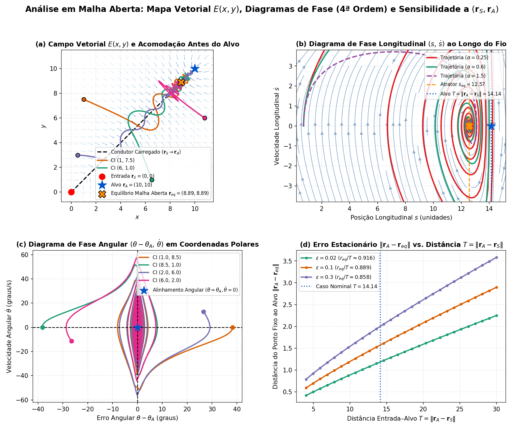
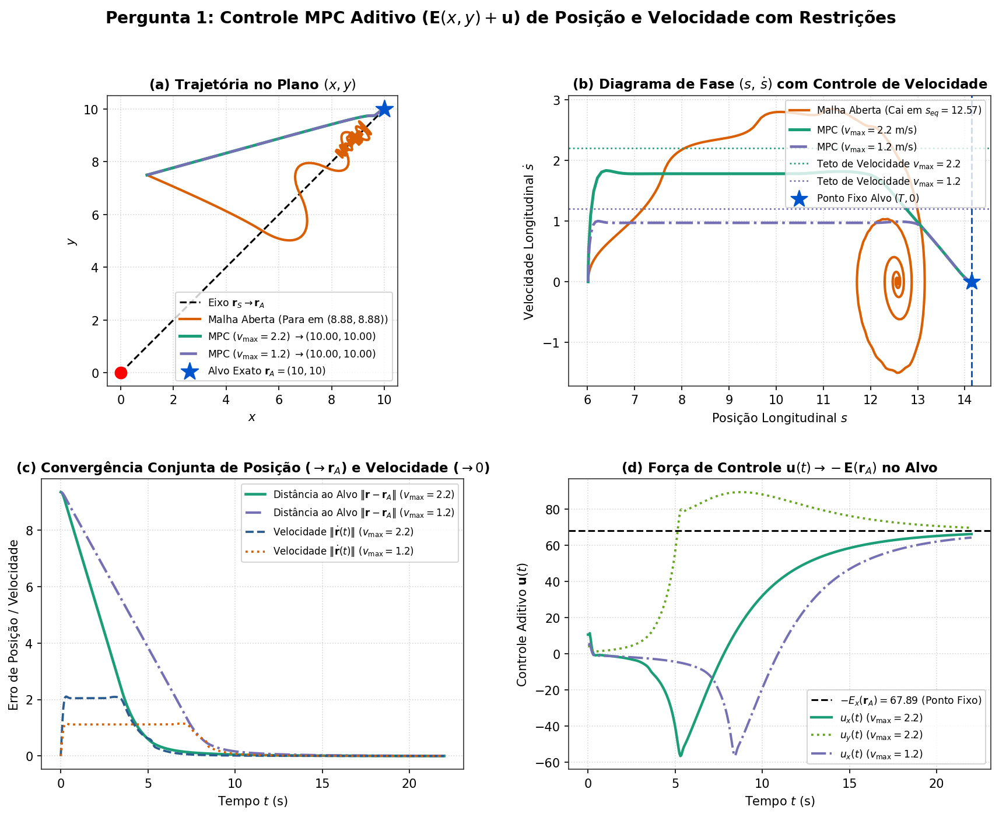
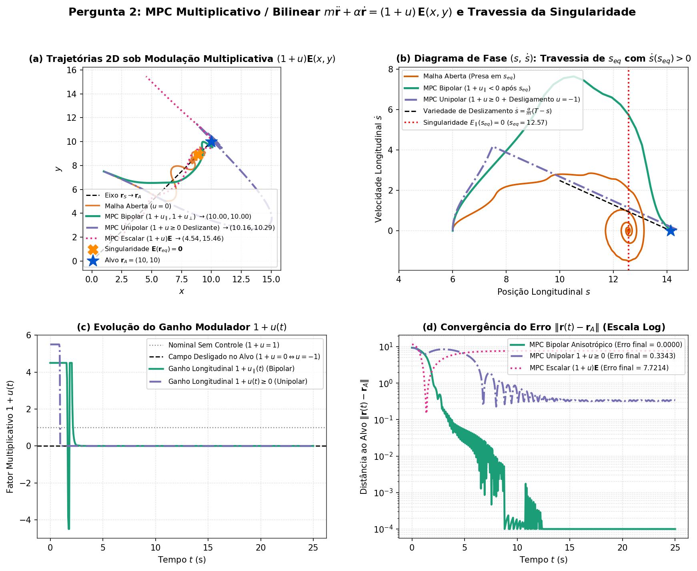
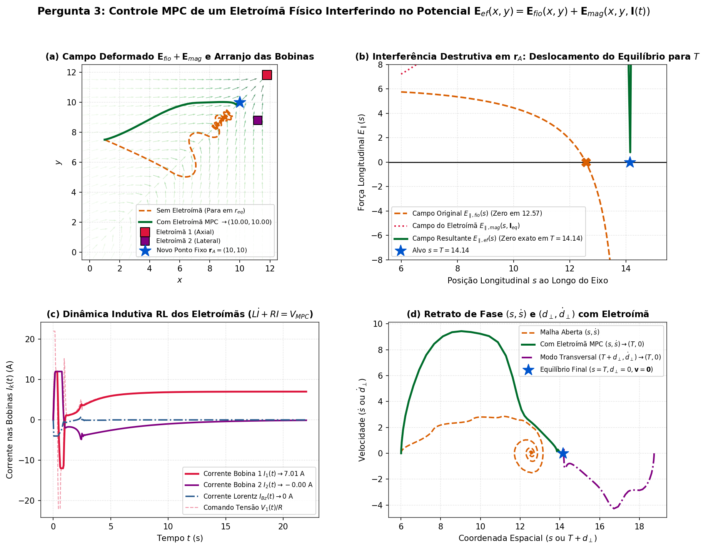
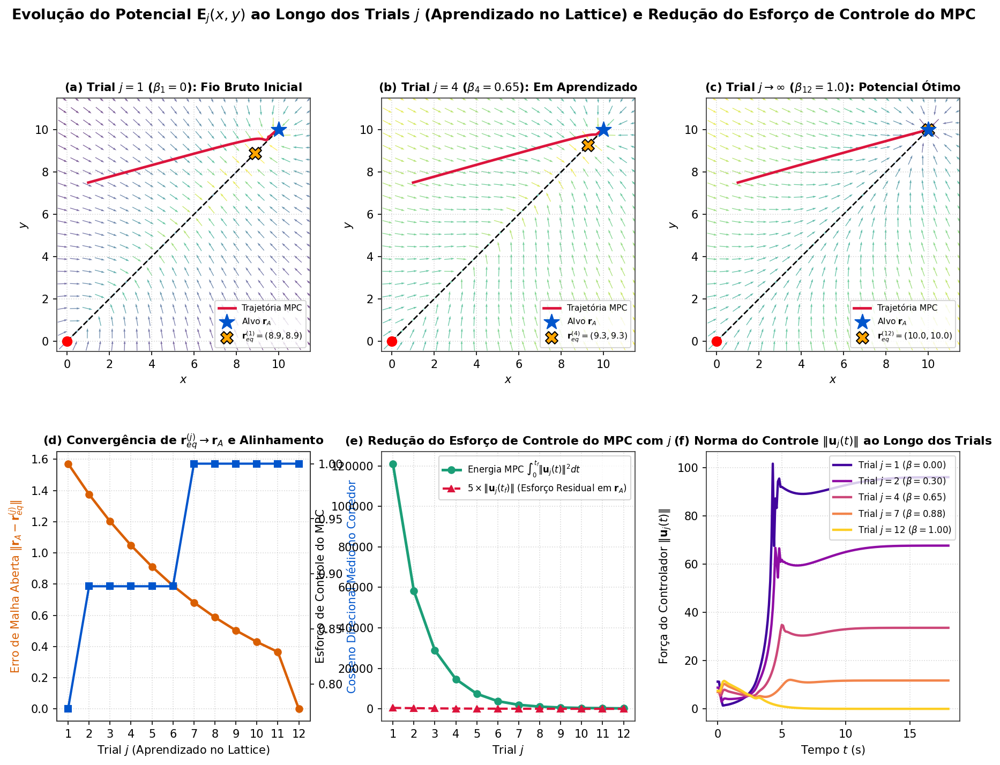

# Controle Preditivo Baseado em Modelo (MPC) em Sistema Dinâmico Guiado por Campo Potencial Anisotrópico Evolutivo $E_j(x,y)$

Estudo teórico e experimental completo de **Sistemas Dinâmicos de 4ª Ordem** e **Controle Preditivo (MPC / GPC)** aplicado à navegação de um caminhante físico em campo de potencial motivado por experimentos de aprendizado em grade (*lattice*).

---

## 📌 Contexto e Motivação Física

Em experimentos de aprendizado por reforço em grade (*lattice*), um agente caminha da **Entrada** $S = (0,0)$ até o **Alvo** $A = (10,10)$ em sucessivos *trials* ($j = 1, 2, \dots$). As probabilidades de transição espacial compõem um mapa vetorial médio que quebra a simetria radial e cria um corredor direcional alinhado ao vetor $S \to A$.

O sistema contínuo subjacente de 4ª ordem ($\mathbf{x} = [x, \dot{x}, y, \dot{y}]^T$) é modelado por:
$$m \ddot{\mathbf{r}}(t) + \alpha \dot{\mathbf{r}}(t) = \mathbf{E}(x,y)$$

### O Problema em Malha Aberta
No potencial clássico do condutor finito carregado, toda a distribuição de carga fica para trás conforme a partícula se aproxima de $A$, exercendo uma força residual não-nula $\mathbf{E}(\mathbf{r}_A) = (-67.89, -67.89)\text{ N}$. Como consequência, o atrator natural ocorre antes do alvo em $\mathbf{r}_{eq} = (8.89, 8.89)$, com erro estacionário de $\approx 1.57$ unidades. A proporção $s_{eq}/T \approx 0.889$ é invariante, fazendo com que o desvio cresça linearmente com a distância $T = \|\mathbf{r}_A - \mathbf{r}_S\|$.

---

## 🔬 Estrutura das Simulações e Resultados

### 1. Malha Aberta, Retratos de Fase e Sensibilidade
- **Análise Polar e Longitudinal**: Decomposição em coordenadas longitudinais $s(t)$ ao longo do eixo $S \to A$ e transversais $d_\perp(t)$.
- **Diagrama de Fase $(s, \dot{s})$ e $(\theta - \theta_A, \dot{\theta})$**: Demonstração do foco atrator e sensibilidade paramétrica à distância $T$.



---

### 2. Pergunta 1: MPC Aditivo ($\mathbf{E}(x,y) + \mathbf{u}$) para Posição e Velocidade
- **Formulação no Espaço de Estados**: Discretização exata ZOH de 4ª ordem com horizonte $N_p = 20$.
- **Restrições Explícitas**: Garantia de velocidade máxima $\|\dot{\mathbf{r}}(t)\|_2 \le v_{\max}$ via barreira quadrática suave no QP.
- **Ponto Fixo Exato**: $\mathbf{u}_\infty = -\mathbf{E}(\mathbf{r}_A) = (+67.89, +67.89)\text{ N}$, cravando $\mathbf{r}(t_f) = (10.00, 10.00)$ e $\dot{\mathbf{r}}(t_f) = \mathbf{0}$.



---

### 3. Pergunta 2: MPC Multiplicativo / Bilinear $(1 + u)\,\mathbf{E}(x,y)$
- **Travessia da Singularidade**: Em $\mathbf{r}_{eq}$, $\mathbf{E}(\mathbf{r}_{eq}) = \mathbf{0}$. O MPC bombeia energia cinética antes de $s_{eq}$ ($1+u > 1$) para atravessar o ponto crítico por inércia com $\dot{s}(s_{eq}) > 0$.
- **Ponto de Parada no Alvo**: Como $\mathbf{E}(\mathbf{r}_A) \neq \mathbf{0}$, a condição de repouso assintótico é $1 + u_\infty = 0 \iff u_\infty = -1$ (desligamento do campo no alvo).
- **Regimes Investigados**:
  1. *Bipolar Anisotrópico* ($(1+u_\parallel)\mathbf{E}_\parallel + (1+u_\perp)\mathbf{E}_\perp$): Erro zero ($0.00000$).
  2. *Unipolar Deslizante* ($1+u \ge 0$): Acelera até a variedade viscosa $\dot{s} = \frac{\alpha}{m}(T - s)$ e desliga o campo, deslizando suavemente até o alvo.
  3. *Bipolar Escalar Puro*: Demonstração da instabilidade de sela transversal pós-$s_{eq}$.



---

### 4. Pergunta 3: MPC com Atuador Eletroímã Físico Externo
- **Sistema Eletromagnético Acoplado de 7ª Ordem**:
  - Força de gradiente espacial das bobinas $\mathbf{E}_{\text{mag}}(\mathbf{r}, I_1, I_2)$;
  - Força giroscópica de Lorentz $\mathbf{F}_L = q\,\dot{\mathbf{r}} \times \mathbf{B}_z$ para correção angular ortogonal;
  - Dinâmica indutiva das bobinas $L\dot{I} + RI = V_{\text{MPC}}(t)$ ($\tau_{RL} = 0.20\text{ s}$).
- **Interferência Destrutiva**: Corrente estacionária $I_{1,eq} \approx 7.0\text{ A}$ cancela a força residual do fio e desloca o zero do potencial resultante diretamente para cima do alvo $\mathbf{r}_A = (10,10)$.



---

### 5. Pergunta 4: Evolução Multi-Trial do Potencial $\mathbf{E}_j(x,y)$
- **Potencial de Aprendizado Radial-Longitudinal**:
  $$\mathbf{E}_j(x,y) = (1 - \beta_j)\,\mathbf{E}_{\text{fio}}(x,y) + \beta_j\,\mathbf{E}_{\text{ótimo}}(x,y)$$
- **Convergência quando $j \to \infty$**:
  - Alinhamento direcional médio com o vetor $S \to A$: de $0.33$ para $1.00$.
  - Erro de malha aberta: de $1.57$ para $0.00$.
  - Esforço de controle do MPC: **redução de 99.8%** na energia integrada $L_2$, com esforço residual final nulo no alvo.



---

## 📂 Arquivos do Repositório

| Arquivo | Descrição |
|---|---|
| `estudo_completo_mpc_potencial.py` | Script Python com toda a modelagem, controladores MPC e gerador das figuras/PDF |
| `demo_gpc_potencial.py` | Implementação do GPC CARIMA no tempo e evolutivo Run-to-Run |
| `Relatorio_Explicativo_Simulacoes_MPC.pdf` | **Relatório técnico completo de 10 páginas** (teoria, deduções e gráficos) |
| `Estudo_Completo_MPC_Potencial_Evolutivo.pdf` | Versão consolidada do relatório técnico para impressão/leitura |
| `fig1_*.png` a `fig5_*.png` | Gráficos e retratos de fase individuais em alta resolução (150 DPI) |

---

## 🚀 Como Executar

```bash
# Dependências necessárias
pip install numpy scipy matplotlib

# Executar todas as simulações e gerar os gráficos e relatórios PDF
python estudo_completo_mpc_potencial.py
```
